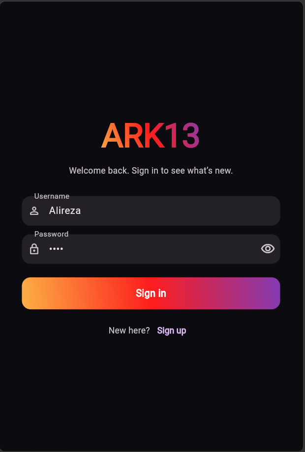
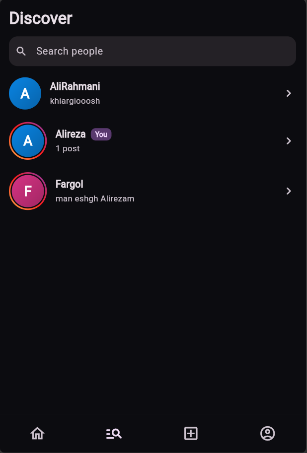
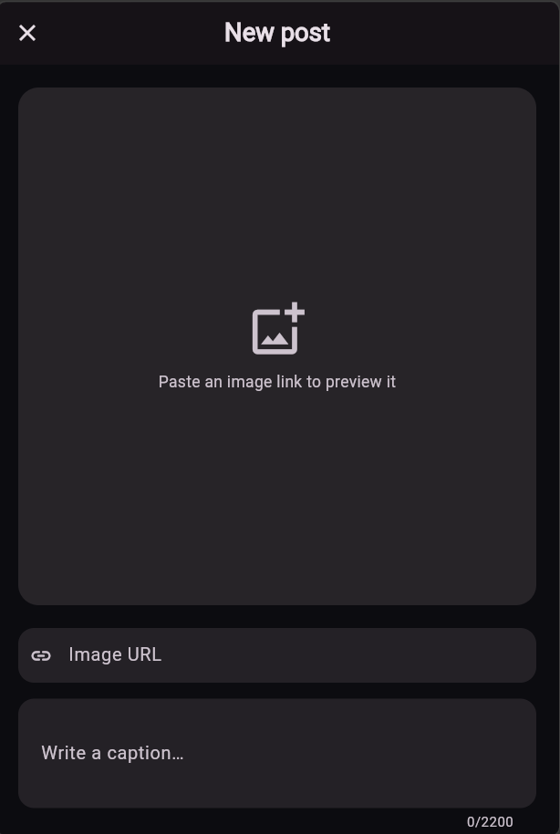
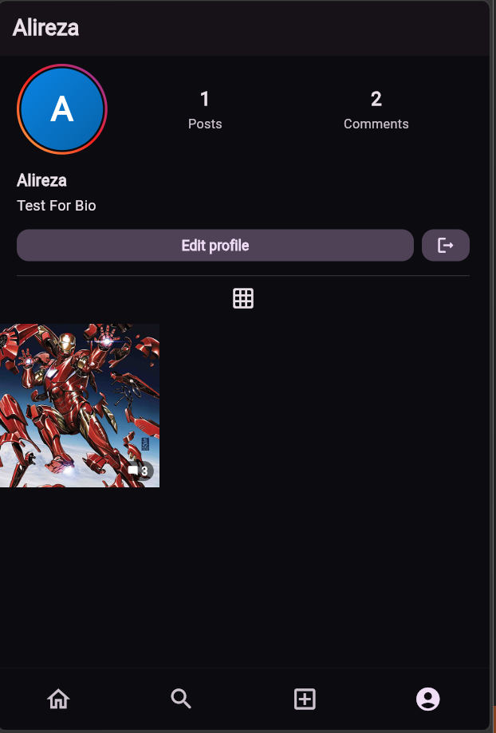

# Instagram Flutter App

A modern Instagram-inspired social media application built with **Flutter** and **Dart**, integrated with a custom **FastAPI REST API**.

The application brings together authentication, a personalized feed, user discovery, profile pages, and post management in a dark-themed mobile interface.

## Screenshots

### Sign In


### Home Feed


### Discover


### Create a Post


### User Profile


## Features

### Authentication
- Sign-in interface.
- User registration interface.
- Authenticated API requests.

### Home Feed
- Browse posts from users.
- Display post images and captions.
- Navigate through the application.

### Discover
- Browse available users.
- Search for people by username.
- Open user profiles.

### Post Management
- Create posts using image URLs.
- Add captions to posts.
- Edit existing posts.
- Delete posts.
- View posts in the feed and on profiles.

### User Profiles
- View user information.
- Display profile details and bio.
- View user posts.
- Edit profile information.

### UI and Navigation
- Dark-themed interface.
- Bottom navigation.
- Dedicated screens for the feed, discover, creating posts, and profiles.
- Consistent visual styling.

## Technologies

| Technology | Purpose |
|---|---|
| Flutter | Cross-platform UI framework |
| Dart | Programming language |
| FastAPI | Backend REST API |
| Python | Backend programming language |
| SQLAlchemy | Database ORM |
| SQLite | Database |
| JWT | Authentication |

## Related Backend

This application connects to a separate FastAPI backend:

**[FastAPI Instagram API](https://github.com/ARK13-org/FastAPI-Instagram-API)**

The backend provides functionality for:
- User accounts and authentication.
- Post creation and management.
- Comment management.
- Image uploads.
- User profiles.

## Getting Started

### 1. Clone the repository

```bash
git clone https://github.com/ARK13-org/Instagram-Flutter-App.git

cd Instagram-Flutter-App
```

### 2. Install dependencies

```bash
flutter pub get
```

### 3. Configure the backend connection

Make sure the FastAPI backend is running.

Configure the API base URL in the Flutter application to point to your backend.

For Android emulator development, use:

```text
http://10.0.2.2:8000
```

For physical-device testing, use your computer's local network IP address.

### 4. Run the application

```bash
flutter run
```

## Project Structure

```text
Instagram-Flutter-App/
│
├── lib/
│   ├── api/
│   ├── models/
│   ├── screens/
│   ├── widgets/
│   └── main.dart
│
├── assets/
├── screenshots/
├── test/
├── pubspec.yaml
└── README.md
```

*The structure above illustrates the main application areas; actual folders may vary.*

## Related Project

The backend and Flutter application are maintained in separate repositories:

- **Frontend:** [Instagram-Flutter-App](https://github.com/ARK13-org/Instagram-Flutter-App)
- **Backend:** [FastAPI-Instagram-API](https://github.com/ARK13-org/FastAPI-Instagram-API)

## What I Learned

Through this project, I practiced:

- Building multi-screen Flutter applications.
- Managing application navigation.
- Connecting Flutter to REST APIs.
- Handling authentication and JWT tokens.
- Working with JSON responses and API models.
- Implementing post management.
- Building user discovery and profile interfaces.
- Integrating a Flutter frontend with a FastAPI backend.

## Project Goal

The goal of this project is to build an Instagram-inspired mobile application while improving my Flutter development skills and gaining practical experience integrating a mobile frontend with a custom backend.
